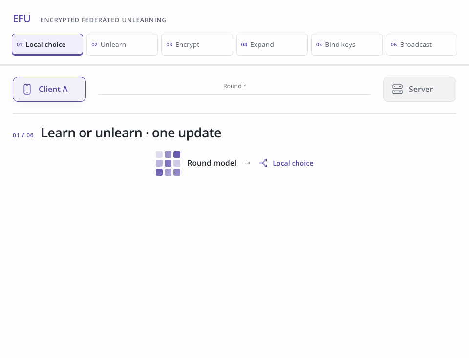

<h1 align="center">EFU</h1>
<p align="center"><strong>Enforcing Federated Unlearning via Functional Encryption</strong></p>
<p align="center">Samaneh Mohammadi · <a href="https://vtsouval.github.io/"><strong>Vasileios Tsouvalas</strong></a> · Iraklis Symeonidis · Ali Balador · Tanir Ozcelebi · Francesco Flammini · Nirvana Meratnia</p>

<p align="center">
  <a href="https://doi.org/10.1145/3746252.3761091" title="Read the paper"></a>
  <picture></picture>
  <a href="https://nousphera.github.io/projects/efu/" title="Explore the project"></a>
  <picture></picture>
  <a href="https://nousphera.github.io/assets/posters/efu-a0-landscape.pdf" title="View the poster"></a>
</p>

## Abstract

**EFU** combines *client-side unlearning* with **function-bound encrypted aggregation**. A requesting client counteracts forgotten examples through negative cross-entropy, adversarial examples and *inverted Memory Aware Synapses (MAS)* regularization. Clients then cluster and encrypt their updates, authorizing a **sample-weighted aggregate**. The implementation supports sample, class and identity-task forgetting, with retained-data recovery and comparisons against retraining, PGD, SGA-EWC and FedOSD.

<p align="center">
  <a href="https://nousphera.github.io/projects/efu/" title="Explore the interactive method">
    <picture>
      <source media="(max-width: 600px) and (prefers-color-scheme: dark)" srcset="docs/assets/readme/method-dark-mobile.gif">
      <source media="(max-width: 600px)" srcset="docs/assets/readme/method-light-mobile.gif">
      <source media="(prefers-color-scheme: dark)" srcset="docs/assets/readme/method-dark.gif">
      
    </picture>
  </a>
</p>

## Setup

Create and activate the `efu` environment:

```bash
git clone https://github.com/Nousphera/EFU.git
cd EFU
python3.11 -m venv --prompt efu .venv
source .venv/bin/activate
```

From the activated `efu` environment, install the requirements:

```bash
python -m pip install -r requirements.txt
```

## Data and Weights

Download, prepare and validate the datasets:

```bash
# One dataset
python scripts/prepare_data.py --dataset cifar10

# All paper datasets
python scripts/prepare_data.py
```

**Datasets:** `cifar10` · `femnist` (62 classes) · `lfw` (30 identities). Preparation retains deterministic splits and source hashes.

### Prepare Model

```bash
# ResNet-18
python scripts/prepare_model.py --model resnet18

# Both paper architectures: ResNet-18 and ViT-B/32
python scripts/prepare_model.py
```

Models use checksum-verified **torchvision ImageNet-1K V1** weights; prepared runs load them locally. Select `--model vit_b_32` for ViT-B/32.

## Run Experiments

From the repository root, choose a method for the Flower simulation:

```bash
common=(--dataset cifar10 --model resnet18 --clients 10 --rounds 100
        --participation 0.2 --alpha 0.1 --local-epochs 1 --batch-size 64
        --unlearn-start 51 --unlearn-rounds 10 --unlearn-epochs 5
        --forget-client 0 --forget-fraction 0.1 --kappa 64
        --precision 3 --max-abs 32 --device cuda)

# EFU (ours)
python scripts/run_experiment.py "${common[@]}"

# EFU + projected gradient descent (PGD)
python scripts/run_experiment.py "${common[@]}" --unlearn-method pgd

# PGD
python scripts/run_experiment.py "${common[@]}" \
  --unlearn-method pgd --variant baseline --aggregation plaintext

# Stochastic gradient ascent + elastic weight consolidation (SGA-EWC)
python scripts/run_experiment.py "${common[@]}" \
  --unlearn-method sga_ewc --variant baseline --aggregation plaintext

# FedOSD
python scripts/run_experiment.py "${common[@]}" \
  --unlearn-method fedosd --variant baseline --aggregation plaintext

# FedOSD + EFU's MAS objective
python scripts/run_experiment.py "${common[@]}" \
  --unlearn-method fedosd --variant efu --aggregation plaintext

# Retained-data retraining / ordinary FedAvg
python scripts/run_experiment.py "${common[@]}" --method retrain
python scripts/run_experiment.py "${common[@]}" --method fedavg
```

> [!NOTE]
> Rounds are one-based: 50 learning rounds, unlearning in rounds 51–60, then retained-data recovery. FedOSD needs cohort gradients and therefore uses plaintext aggregation. PGD forces requesting clients into its preparation cohort; `--pgd-radius` sets its L2 radius. SGA-EWC uses empirical Fisher importance (`--fisher-source forget`).

For class requests, add `--forget-classes 0 1`; for multiple requesters, use `--forget-clients 0 1`. `--seed` controls training, `--partition-seed` fixes partitions and `--request-seed` fixes forgotten examples. `--output` selects a new run name; metrics and final weights are saved under `results/`.

### Identity Forgetting

Supply LFW gender annotations as `path,gender` CSV rows, with paths relative to the original LFW directory and two explicitly supplied categories:

```bash
python scripts/prepare_data.py --dataset lfw --root data-lfw-task \
  --gender-annotations raw/lfw-gender.csv
python scripts/run_experiment.py --task identity-gender --dataset lfw \
  --data-root data-lfw-task \
  --model vit_b_32 --clients 30 --participation 1 --device cuda
```

The shared backbone learns identity and gender, then all clients forget identity while retaining gender. Annotations are imported, never inferred. Task-level FedOSD projects against retained **gender-objective** gradients.

### Aggregation

Each simulated client trains on its assigned partition and keeps update and key material in private Flower state. Encrypted updates carry centroids, position mappings and mapping-bound authorization shares; all floating model state is protected. Results separate ciphertext, mapping and authorization payload sizes.

> [!NOTE]
> The protocol assumes authenticated peers and a semi-honest server. Visible mappings and aggregates can reveal centroid relationships; the request schedule is public. Encryption constrains authorized decryption; it does not compel server deployment or prove exact data removal. The paper does not identify its pretrained checkpoint, so the selected V1 weights and experiment settings are recorded explicitly.

## Citation

```bibtex
@inproceedings{mohammadi2025efu,
  title = {{EFU}: Enforcing Federated Unlearning via Functional Encryption},
  author = {Mohammadi, Samaneh and Tsouvalas, Vasileios and Symeonidis, Iraklis and Balador, Ali and Ozcelebi, Tanir and Flammini, Francesco and Meratnia, Nirvana},
  booktitle = {Proceedings of the 34th ACM International Conference on Information and Knowledge Management},
  year = {2025},
  pages = {2148--2158},
  publisher = {Association for Computing Machinery},
  doi = {10.1145/3746252.3761091},
  url = {https://doi.org/10.1145/3746252.3761091}
}
```

[License](LICENSE)
