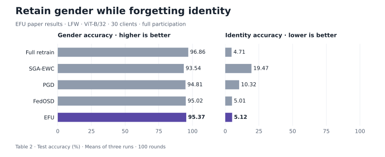

# EFU

**EFU: Enforcing Federated Unlearning via Functional Encryption**

[ Paper](https://doi.org/10.1145/3746252.3761091) · [ Project](https://nousphera.github.io/projects/efu/) · [ Code](https://github.com/Nousphera/EFU) · [ Preprint](https://arxiv.org/abs/2508.07873) · [ Poster](https://nousphera.github.io/assets/posters/efu-a0-landscape.pdf) · [Citation](CITATION.cff)

Samaneh Mohammadi · Vasileios Tsouvalas · Iraklis Symeonidis · Ali Balador · Tanir Ozcelebi · Francesco Flammini · Nirvana Meratnia

ACM CIKM 2025

<p align="center">
  <a href="https://nousphera.github.io/projects/efu/#findings">
    <picture>
      <source media="(prefers-color-scheme: dark)" srcset="docs/assets/readme/results-dark.svg">
      <source media="(prefers-color-scheme: light)" srcset="docs/assets/readme/results-light.svg">
      
    </picture>
  </a>
</p>

*Paper results: identity forgetting with gender retention on LFW, ViT-B/32; 30 clients, full participation, 100 rounds. [Table 2](https://arxiv.org/pdf/2508.07873v1#page=10), means of three runs. Explore the [interactive findings](https://nousphera.github.io/projects/efu/#findings).*

## Abstract

Federated unlearning (FU) algorithms allow clients in federated settings to exercise their “right to be forgotten” by removing the influence of their data from a collaboratively trained model. Existing FU methods maintain data privacy by performing unlearning locally on the client-side and sending targeted updates to the server without exposing forgotten data; yet they often rely on server-side cooperation, revealing the client's intent and identity without enforcement guarantees - compromising autonomy and unlearning privacy. In this work, we propose EFU (Enforced Federated Unlearning), a cryptographically enforced FU framework that enables clients to initiate unlearning while concealing its occurrence from the server. Specifically, EFU leverages functional encryption to bind encrypted updates to specific aggregation functions, ensuring the server can neither perform unauthorized computations nor detect or skip unlearning requests. To further mask behavioral and parameter shifts in the aggregated model, we incorporate auxiliary unlearning losses based on adversarial examples and parameter importance regularization. Extensive experiments show that EFU achieves near-random accuracy on forgotten data while maintaining performance comparable to full retraining across datasets and neural architectures - all while concealing unlearning intent from the server. Furthermore, we demonstrate that EFU is agnostic to the underlying unlearning algorithm, enabling secure, function-hiding, and verifiable unlearning for any client-side FU mechanism that issues targeted updates.

## Installation

Python 3.12 is tested; package metadata permits 3.11–3.13. Use a dedicated virtual environment. Linux needs a C/C++ toolchain, Python development headers, GMP and libffi development libraries (for example, `build-essential python3-dev libgmp-dev libffi-dev` on Debian/Ubuntu). macOS needs Python 3.12 and the standalone Command Line Tools; install GMP/libffi if native cryptographic wheels are unavailable. On Windows, use WSL2 with the Linux prerequisites; native Windows is untested.

```bash
git clone https://github.com/Nousphera/EFU.git
cd EFU
bash scripts/setup.sh .venv
source .venv/bin/activate
python -m pytest -q
```

The setup script creates the venv, installs `requirements.txt` with the tested `constraints.txt`, and runs `pip check`. On macOS it selects the installed standalone Command Line Tools. Equivalent manual setup:

```bash
python3.12 -m venv .venv
source .venv/bin/activate
# macOS with standalone Command Line Tools:
# export DEVELOPER_DIR=/Library/Developer/CommandLineTools
python -m pip install -c constraints.txt -r requirements.txt
```

Requirements install the vendored PyMIFE source and native cryptographic dependencies. Installation and tests do not download datasets or model weights. See [third-party licenses](THIRD_PARTY_LICENSES).

## Data

Prepare once, validate, and pass the same parent root to training:

```bash
python scripts/prepare_data.py --dataset cifar10 --root data --download
python scripts/prepare_data.py --dataset cifar10 --root data --validate
```

This fetches the official [CIFAR](https://www.cs.toronto.edu/~kriz/cifar.html) Python data through torchvision's checksum-verified loader, preserving its 50,000/10,000 train/test split. Use `cifar100` for CIFAR-100. Output lives under `data/cifar10/`, including `manifest.json` with file SHA256 hashes, class mapping and split sizes. To import an existing torchvision CIFAR root, use `--source /path/to/extracted-cifar-root` instead of `--download`. Existing prepared roots are never overwritten.

For EFU's additional datasets, import acquired LFW identity folders or LEAF FEMNIST JSON:

```bash
python scripts/prepare_data.py --dataset lfw --source /path/to/lfw --root data --identities 30 --split-seed 2025
python scripts/prepare_data.py --dataset femnist --source /path/to/leaf/data/femnist/data --root data
python scripts/prepare_data.py --dataset femnist --root data --validate
```

LFW uses a documented, seeded identity-classification split; FEMNIST retains writer IDs and all 62 label indices. These imports feed the same learning/unlearning trainer. See [dataset acquisition and split conventions](DATASETS.md). The [two-head identity-forgetting/gender-retention route](TASK_UNLEARNING.md) accepts explicit supplied annotations.

For an explicit image dataset split, use `--dataset imagefolder --source /path/to/splits`, where the source contains `train/CLASS/*` and `test/CLASS/*`. Validation checks class agreement, readable images, exact duplicate image content across splits and file changes. [DATASETS.md](DATASETS.md) gives the complete layout and limits; `python scripts/prepare_data.py --help` lists all options.

## Training

A bounded offline check trains the full paper architecture on generated images with plaintext FedAvg:

```bash
efu-train --method fedavg --samples-per-client 2 --rounds 1 --output runs/check.json
```

Run the prepared CIFAR data through the same primary trainer:

```bash
efu-train --dataset cifar10 --data-root data --model resnet18 --pretrained \
  --clients 10 --participation 0.2 --rounds 100 --alpha 0.1 \
  --batch-size 64 --lr 0.001 --kappa 64 --precision 3 \
  --unlearn-start 51 --unlearn-rounds 10 --unlearn-epochs 5 --attack-steps 100 --output runs/cifar10.json
efu-train --help
```

`--method fedavg|retrain` provides plaintext controls. `--method efu --aggregation plaintext` isolates the same EFU unlearning objective and schedule without encryption; the default aggregation is encrypted. Define a request with `--forget-client`, `--forget-fraction` or `--forget-class`, `--unlearn-start`, `--unlearn-rounds` and `--unlearn-epochs`. Scheduled unlearning always includes the requester. `--attack-steps 100` uses 100 APGD iterations; the smoke-test default is 2. Models `resnet18` and `vit_b_32` support explicit `--pretrained` weight downloads. `--partition writer` preserves FEMNIST writers as clients and requires `--clients` to equal the manifest's training-writer count. The default is seeded Dirichlet label partitioning.

For task-level unlearning, supply a per-image `path,gender` CSV during LFW preparation
with `--gender-annotations`, then select the two-head route:

```bash
efu-train --task identity-gender --dataset lfw --data-root data --model vit_b_32 --pretrained \
  --clients 30 --alpha 0.1 --rounds 100 --unlearn-start 51 --unlearn-rounds 10 \
  --batch-size 64 --lr 0.001 --unlearn-epochs 5 --attack-steps 100 \
  --precision 3 --kappa 64 --output runs/lfw-task.json
```

All clients forget identity while retaining gender, then continue with gender-only
training. [TASK_UNLEARNING.md](TASK_UNLEARNING.md) specifies annotation coverage,
loss routing, controls, backbone choices and evaluation. No gender labels
are inferred.

The runner simulates clients and aggregation in one process. Synthetic images check execution only; their metrics are not benchmark results. Encrypted runs process every model coordinate and can be expensive.

## Evaluation

The trainer evaluates the held-out test split after every round and writes `accuracy` and cross-entropy `loss` to `history`. Single-task unlearning also records `forget_train_accuracy` on the requested training subset. The identity–gender route records separate held-out identity and gender metrics under each round's `test` field; see [task evaluation](TASK_UNLEARNING.md#outputs-and-validation).

Inspect the final evaluation from a run above:

```bash
python - <<'PYTHON'
import json
from pathlib import Path
report = json.loads(Path("runs/cifar10.json").read_text())
print(json.dumps(report["history"][-1], indent=2))
PYTHON
```

Accuracy values in run reports are fractions in `[0, 1]`. Retained and forgotten accuracies in the paper's class-wise tables use separate test subsets; `forget_train_accuracy` is a training-subset measurement.

### Saved outputs

Each named run saves JSON containing configuration, data-manifest hash, exact client partitions, participant/sample counts, metrics and environment versions. A sibling `.pt` stores the final CPU state dictionary and configuration, loadable with `torch.load(..., weights_only=True)`. Existing JSON/checkpoint paths are protected; choose a new output name to rerun. Save the input manifest and run `--validate` before a research experiment; training checks label/split identity, while full file hashing is an explicit preparation check.

## Pretrained models

`--model resnet18 --pretrained` and `--model vit_b_32 --pretrained` initialize the backbone with torchvision's ImageNet weights. Both are full torchvision architectures with 224×224 RGB inputs; omitting `--pretrained` trains the same architecture from scratch. The paper specifies Hugging Face ImageNet weights without an exact checkpoint identifier; torchvision weights are explicitly identified here and are not claimed to be the identical paper checkpoint. Each training run writes its final model to the `.pt` checkpoint described above. [Task training](TASK_UNLEARNING.md#execute) documents backbone selection for the shared identity–gender model.

## Results

The paper reports the following LFW task-unlearning results with ViT-B/32: all 30 clients remove identity classification after 50 joint-training rounds while retaining gender classification; 100 rounds in total, full participation. Values are mean test accuracies over three runs, from [Table 2](https://arxiv.org/pdf/2508.07873v1#page=10).

| Method | Gender accuracy ↑ (%) | Identity accuracy ↓ (%) |
|---|---:|---:|
| Full retrain | 96.86 | 4.71 |
| SGA-EWC | 93.54 | 19.47 |
| PGD | 94.81 | 10.32 |
| FedOSD | 95.02 | 5.01 |
| **EFU** | **95.37** | **5.12** |

EFU retains gender accuracy within 1.49 percentage points of full retraining, with identity accuracy close to the retraining reference. For CIFAR-10 class-wise forgetting with ResNet-18, [Table 1(a)](https://arxiv.org/pdf/2508.07873v1#page=9) reports 92.43% retained and 13.06% forgotten accuracy for EFU, versus 94.82% and 13.72% for retraining. See the [project findings](https://nousphera.github.io/projects/efu/#findings) for the experiment settings and comparisons.

## Protocol

The implementation uses decentralized, coordinate-labelled functional encryption on P-256. Clients cluster weights, expand their local vector, and encrypt each coordinate with a unique session/round/position label. Each client sends **d ciphertexts for d model coordinates**; the paper's compressed transport uses κ encrypted centroids. These are different communication and encryption costs. Client secrets stay in client objects; the aggregation object holds public parameters and functional shares. BatchNorm buffers are aggregated in plaintext.

All selected clients must contribute to a round. This local simulator uses in-process message delivery; network authentication, process isolation and dropout recovery require a separate deployment layer.


Public setup fixes the active cohort, positive integer sample counts, parameter layout, precision and absolute bound. Clients generate independent secrets, exchange pairwise public keys and generate functional shares; the server checks participant IDs, function weights, dimensions and labels. Each selected client must reply. Cryptographic keys use OS entropy independently of the training seed; a changed cohort receives fresh setup.

Weights are rounded after multiplication by `10**precision`. Decryption divides the integer weighted sum by `sum(sample_counts) * 10**precision`; its rounding error is at most `0.5 / 10**precision` per coordinate relative to the reconstructed clustered mean. Nonfinite and out-of-bound weights fail. The public decryption interval is fixed at setup to `±ceil(max_abs * 10**precision + 0.5) * sum(sample_counts)`, and is reused only for that cohort/configuration. Larger bounds, precision and dimensions increase discrete-log work; clustering adds approximation error and coarse precision can erase updates.

EFU prepares targeted L2 APGD attacks, incorrect labels, inverted-MAS importance and reference weights once per request, then reuses them across its unlearning window. The local objective combines negative forget cross-entropy, adversarial cross-entropy and inverted-MAS drift penalty. BatchNorm integer counters use the maximum client value. See [task unlearning](TASK_UNLEARNING.md) for dual-head losses and scheduling.

The bounded test suite exercises full paper architectures, image preparation, forward/backward passes, plaintext training and checkpoints. Separate small-array tests execute real P-256 encryption, weighted aggregation and malformed-message rejection. It does not encrypt an entire production backbone in CI and does not reproduce the paper benchmarks. Run `python -m pytest -q` and `python -m pip check`; tested dependency versions are in `constraints.txt`.

## Citation

```bibtex
@inproceedings{mohammadi2025efu,
  title = {{EFU}: Enforcing Federated Unlearning via Functional Encryption},
  author = {Mohammadi, Samaneh and Tsouvalas, Vasileios and Symeonidis, Iraklis and Balador, Ali and Ozcelebi, Tanir and Flammini, Francesco and Meratnia, Nirvana},
  booktitle = {Proceedings of the 34th ACM International Conference on Information and Knowledge Management},
  year = {2025},
  pages = {2148--2158},
  publisher = {Association for Computing Machinery},
  doi = {10.1145/3746252.3761091},
  url = {https://doi.org/10.1145/3746252.3761091}
}
```

## License and attribution

[LICENSE](LICENSE) covers the repository software. [THIRD_PARTY_LICENSES](THIRD_PARTY_LICENSES) preserves component attribution and complete third-party terms. Independently buildable vendored packages retain their own license files; dataset and pretrained-model access terms remain separate.
