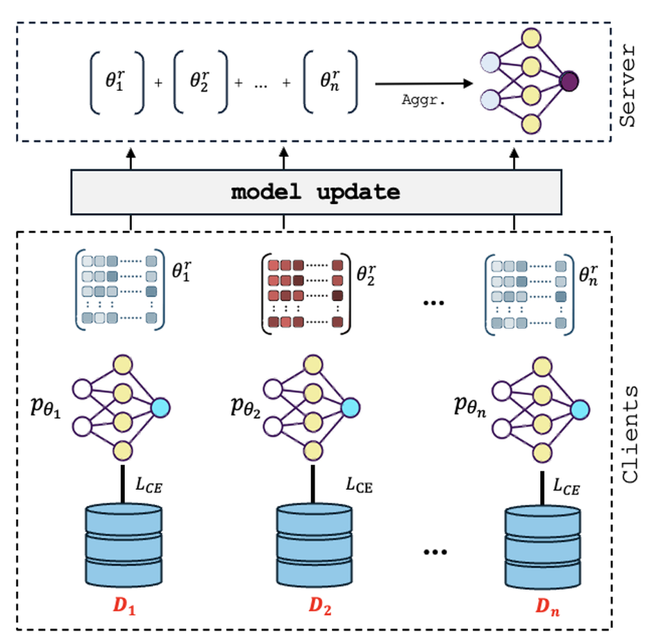
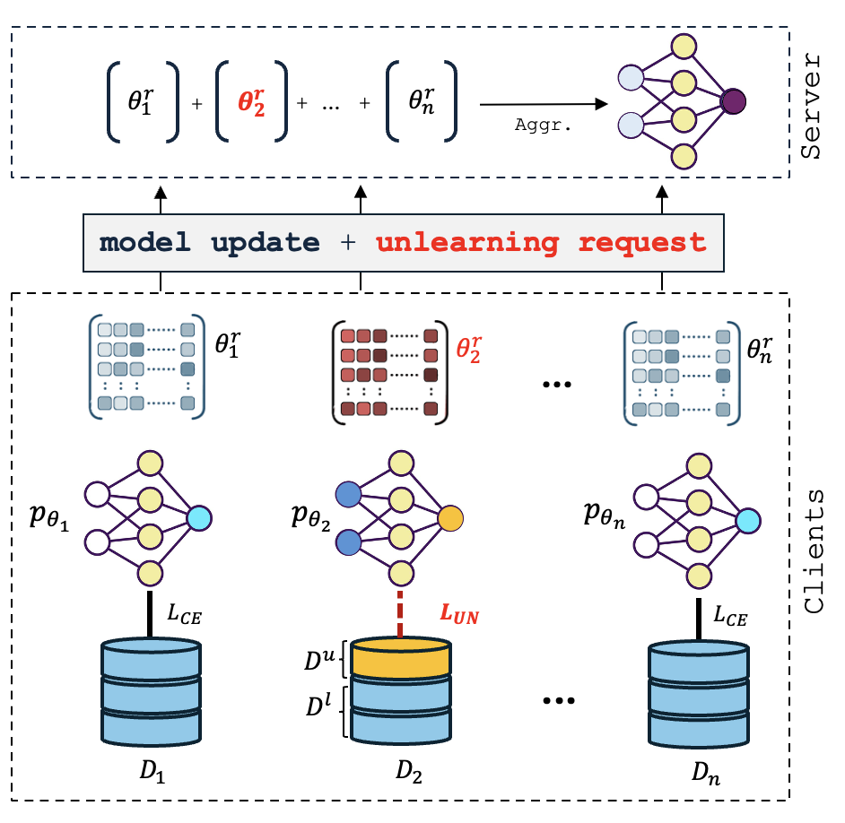

# EFU: Enforceable Federated Unlearning via Functional Encryption

Federated unlearning (FU) algorithms allow clients in federated settings to exercise their right to be forgotten by removing the influence of their data from a collaboratively trained model. Existing FU methods maintain data privacy by performing unlearning locally on the client-side and sending targeted updates to the server without exposing forgotten data; yet they often rely on server-side cooperation, revealing the client's intent and identity without enforcement guarantees - compromising autonomy and unlearning privacy. In this work, we propose EFU (Enforced Federated Unlearning), a cryptographically enforced FU framework that enables clients to initiate unlearning while concealing its occurrence from the server. Specifically, EFU leverages functional encryption to bind encrypted updates to specific aggregation functions, ensuring the server can neither perform unauthorized computations nor detect or skip unlearning requests. To further mask behavioral and parameter shifts in the aggregated model, we incorporate auxiliary unlearning losses based on adversarial examples and parameter importance regularization. Extensive experiments show that EFU achieves near-random accuracy on forgotten data while maintaining performance comparable to full retraining across datasets and neural architectures - all while concealing unlearning intent from the server. Furthermore, we demonstrate that EFU is agnostic to the underlying unlearning algorithm, enabling secure, function-hiding, and verifiable unlearning for any client-side FU mechanism that issues targeted updates.

<table align="center">
  <tr>
    <td align="center">
      
      <div><sub>(a) General Federated Unlearning</sub></div>
    </td>
    <td align="center">
      
      <div><sub>(b) Enforceable Federated Unlearning</sub></div>
    </td>
  </tr>
</table>

Read more details in our [paper](https://dl.acm.org/doi/10.1145/3746252.3761091).

# Running experiments

## Installation

From the `root` of this repo, do the following:

```bash
cd ./src
pip install -r requirements.txt
```

## Experiments

```bash
cd ./src
python main.py --dataset cifar10 --num_clients 10 --forget_samples_percentage 0.1
```

## Cite us

If you like our work, consider giving us a star. To use EFU in your research, please cite our paper:

```bibtex
@inproceedings{10.1145/3746252.3761091,
  author = {Mohammadi, Samaneh and Tsouvalas, Vasileios and Symeonidis, Iraklis and Balador, Ali and Ozcelebi, Tanir and Flammini, Francesco and Meratnia, Nirvana},
  title = {EFU: Enforcing Federated Unlearning via Functional Encryption},
  year = {2025},
  isbn = {9798400720406},
  publisher = {Association for Computing Machinery},
  address = {New York, NY, USA},
  url = {https://doi.org/10.1145/3746252.3761091},
  doi = {10.1145/3746252.3761091},
  booktitle = {Proceedings of the 34th ACM International Conference on Information and Knowledge Management},
  pages = {2148--2158},
}
```
